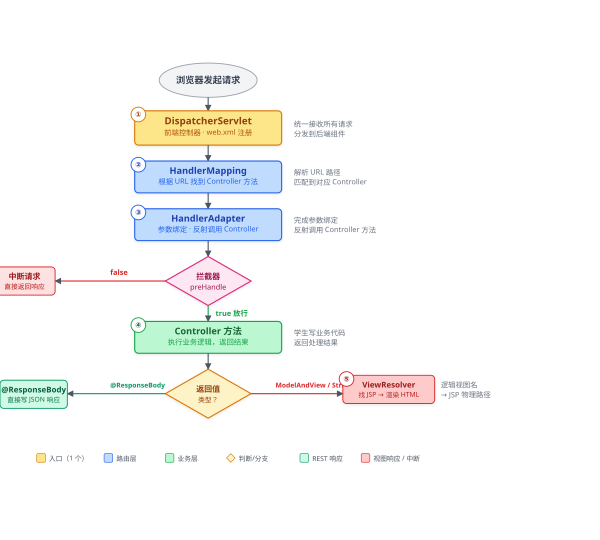

# SpringMVC 基本操作 —— Controller 创建 · 参数绑定 · 页面跳转

> 这是 SpringMVC 的**入门 + 基础**部分，聚焦"如何写 Controller 让它跑起来"。
> 项目采用多 DispatcherServlet 设计：注解方式 `/annotation/*`，XML 方式 `/xml/*`。

---

## 一、SpringMVC 工作流程图（核心组件）



**组件对照表**：

| 组件 | 注解方式 | XML 方式 |
|------|---------|---------|
| HandlerMapping | `RequestMappingHandlerMapping`（`mvc:annotation-driven` 注册） | `BeanNameUrlHandlerMapping`（bean 名即 URL） |
| HandlerAdapter | `RequestMappingHandlerAdapter`（参数绑定/@ResponseBody） | `SimpleControllerHandlerAdapter` |
| ViewResolver | `InternalResourceViewResolver`（本模块两种方式都配了） | 同左 |

**关键分流点**：Controller 方法返回值决定后续走向——
- `@RestController` 写 JSON → **不走** ViewResolver，直接写响应体
- 返回 `ModelAndView` 或字符串 → **走** ViewResolver 找 JSP 渲染

---

## 二、web.xml 入门 —— DispatcherServlet 的注册与路由

> 写 Controller 之前，必须先知道"请求是怎么被送到你 Controller 的"。
> web.xml 是传统 WAR 项目的**启动入口**，SpringMVC 的前端控制器 `DispatcherServlet` 必须在这里注册才能工作。

### 2.1 最小可用的注册模板

```xml
<!-- web.xml -->
<servlet>
    <servlet-name>springmvc</servlet-name>
    <servlet-class>org.springframework.web.servlet.DispatcherServlet</servlet-class>
    <!-- init-param：告诉 DispatcherServlet 去哪里找 SpringMVC 配置文件 -->
    <init-param>
        <param-name>contextConfigLocation</param-name>
        <param-value>classpath:springmvc/annotation/springmvc-servlet.xml</param-value>
    </init-param>
    <!-- load-on-startup=1：Tomcat 启动时就初始化，不要等第一个请求 -->
    <load-on-startup>1</load-on-startup>
</servlet>
<servlet-mapping>
    <servlet-name>springmvc</servlet-name>
    <!-- url-pattern：所有以 /annotation/ 开头的请求都交给它处理 -->
    <url-pattern>/annotation/*</url-pattern>
</servlet-mapping>
```

| 标签 | 作用 | 必须吗 |
|---|---|---|
| `<servlet-class>` | 固定写 `DispatcherServlet` | ✅ 必须 |
| `<contextConfigLocation>` | 指定 SpringMVC 的 XML 配置文件位置 | ✅ 必须（默认找 `/WEB-INF/{servlet-name}-servlet.xml`，不配的话路径要对） |
| `<load-on-startup>` | 启动时初始化，数字越小越先初始化 | 建议加 |
| `<servlet-mapping>` + `<url-pattern>` | URL 路径 → 这个 Servlet 的映射 | ✅ 必须 |

### 2.2 url-pattern 怎么拼出最终 URL

```
Tomcat 端口              →  http://localhost:8080
url-pattern /annotation/* →  /annotation
Controller @GetMapping("/student/hello") →  /student/hello
─────────────────────────────────────────────────────
完整 URL                 →  http://localhost:8080/annotation/student/hello
```

**注意**：`/annotation/*` 的 `/*` 会匹配 `/annotation/` 下所有子路径，但 `/annotation` 本身（不带斜杠结尾）也能匹配。

### 2.3 本项目的三个 DispatcherServlet（一张表看清路由）

| servlet-name | url-pattern | 配置文件 | 对应模块 | 入口 URL 示例 |
|---|---|---|---|---|
| `springmvc-annotation` | `/annotation/*` | `classpath:springmvc/annotation/springmvc-servlet.xml` | 注解方式（RESTful） | `/annotation/student/hello` |
| `springmvc-xml` | `/xml/*` | `classpath:springmvc/xml/springmvc-servlet.xml` | XML 方式 | `/xml/student/list` |
| `ssm` | `/ssm/*` | `classpath:ssm/spring-mvc.xml` | SSM 三层整合 | `/ssm/student/list` |

三个 Servlet **互不干扰**，各有各的子容器、各扫各的包。

### 2.4 Controller 生效的三个前置条件

写了 Controller 类后，必须同时满足：

| 条件 | 在哪配 | 说明 |
|---|---|---|
| ① DispatcherServlet 注册 | web.xml | 没有 Servlet = 没有 SpringMVC |
| ② 组件扫描或 XML 注册 | `springmvc-servlet.xml` | 注解方式要 `<context:component-scan>`；XML 方式要 `<bean name="/xxx">` |
| ③ URL 映射匹配 | Controller 注解 / XML bean name | url-pattern + @RequestMapping 的组合必须和请求 URL 对上 |

> **进阶**：web.xml 中还有父容器监听器 `ContextLoaderListener`、编码过滤器 `CharacterEncodingFilter`，以及多 Servlet 的父子容器关系，详见 **springmvc-advanced知识点.md 第五章「web.xml 全局配置详解」**。

---

## 三、Controller 的两种写法（对照）

### 3.1 注解方式 —— `com.springmvc.controller.StudentController`

```java
@RestController                        // = @Controller + @ResponseBody
@RequestMapping("/student")           // 类级路径前缀
public class StudentController {
    @GetMapping("/list")
    public List<String> list(@RequestParam(required = false) String major) { ... }

    @GetMapping("/detail/{id}")
    public String detail(@PathVariable Integer id) { ... }
}
```

- 方法返回值直接写入响应体（REST 风格），不走视图
- 生效前提：`springmvc/annotation/springmvc-servlet.xml` 里开了 `<mvc:annotation-driven/>` + `<context:component-scan base-package="com.springmvc.controller"/>`

### 3.2 XML 方式 —— `com.springmvc.xml.StudentXmlController`

```java
// 不写任何注解，实现 Controller 接口
public class StudentXmlController implements Controller {
    @Override
    public ModelAndView handleRequest(HttpServletRequest req, HttpServletResponse resp) {
        return new ModelAndView("studentList", "students", students); // 逻辑视图名 + 数据
    }
}
```

```xml
<!-- resources/springmvc/xml/springmvc-servlet.xml 三要素 -->
<bean class="org.springframework.web.servlet.handler.BeanNameUrlHandlerMapping"/>
<bean name="/student/list" class="com.springmvc.xml.StudentXmlController"/>  <!-- bean 名即 URL -->
<bean class="org.springframework.web.servlet.view.InternalResourceViewResolver">
    <property name="prefix" value="/WEB-INF/views/"/>
    <property name="suffix" value=".jsp"/>
</bean>
```

### 3.3 两种方式对比

| 维度 | 注解方式 | XML 方式 |
|------|---------|---------|
| URL 定义位置 | 类/方法上的 `@RequestMapping` | XML 中 `<bean name="...">` |
| 类要求 | 普通类 + `@RestController` | 实现 `Controller` 接口 |
| 返回值 | `@ResponseBody` 响应体 | `ModelAndView` → JSP |
| 适用 | 现代 RESTful 开发（主流） | 理解框架底层机制、遗留代码 |

---

## 四、接收参数的 10 种方式 —— `ParameterController`（`/annotation/param/...`）

| # | 方式 | 写法 | 要点 |
|---|------|------|------|
| 1 | `@RequestParam` | `@RequestParam(defaultValue="18") Integer age` | 查询参数；`required=false` 可空 |
| 2 | `@PathVariable` | `@GetMapping("/path/{id}")` | REST 路径变量，`{}` 名与参数名一致 |
| 3 | 数组 | `@RequestParam String[] hobby` | 同名参数出现多次 |
| 4 | List | `@RequestParam List<Integer> ids` | `ids=1,2,3` 逗号自动拆分 |
| 5 | 实体绑定 | `public String form(Student s)` | **无注解**，参数名==属性名 → setter 注入 |
| 6 | `@RequestBody` | `@PostMapping("/json")` | JSON → 实体；需 Jackson；`Content-Type: application/json` |
| 7 | `@RequestHeader` | `@RequestHeader("User-Agent")` | 取请求头 |
| 8 | `@CookieValue` | `@CookieValue(value="JSESSIONID", required=false)` | 取 Cookie |
| 9 | 原生 API | `HttpServletRequest request, HttpSession session` | 直接声明即可自动传入 |
| 10 | Map | `@RequestParam Map<String,String> params` | 一次收全部参数；**必须加 @RequestParam** 否则被当 Model |

**绑定总规则**：参数名 == 属性名 → 自动注入，类型自动转换（String → Integer/Double...）。
（日期参数绑定 `@DateTimeFormat` 见进阶文档「全局异常处理」旁的补充类）

---

## 五、页面跳转与携带数据 —— `PageController`（`/annotation/page/...`）

### 5.1 跳转的三种写法（返回字符串）

| 写法 | 含义 | 请求次数 | request 域数据 |
|------|------|---------|---------------|
| `"page/show"` | 逻辑视图名（默认转发到 JSP） | 1 次 | 保留 |
| `"forward:/page/model"` | 转发到另一个 Handler | 1 次，URL 不变 | 保留 |
| `"redirect:/page/model?nm=x"` | 重定向 | 2 次，URL 变 | **丢失**（只能靠 URL 参数） |

### 5.2 携带数据的 7 种方式

| # | 方式 | 特点 |
|---|------|------|
| ① | `ModelAndView` | 返回值自带模型：`mv.addObject(...)` |
| ② | `Model`（最常用） | 方法参数：`model.addAttribute(...)` |
| ③ | `ModelMap` | 同 Model，底层 LinkedHashMap |
| ④ | `Map<String,Object>` | 隐式模型，效果同 Model |
| ⑤ | `@ModelAttribute` 方法级 | 公共参数：本 Controller **所有**请求执行前先调用 |
| ⑥ | `HttpSession` | 会话级，跨多次请求存活 |
| ⑦ | `RedirectAttributes` | 重定向专用：`addAttribute`（拼 URL）/ `addFlashAttribute`（Flash 属性存 session，到达后自动入模型并清除） |

**Flash 属性**完美解决"重定向不能带对象"——经典场景：表单提交成功后重定向到列表页并显示提示，刷新不重复提交。

### 5.3 JSP 取值（`WEB-INF/views/page/show.jsp`）

| EL 表达式 | 取的内容 |
|-----------|---------|
| `${name}` | 模型数据（request 域） |
| `${param.nm}` | URL 参数 |
| `${sessionScope.loginUser}` | 会话数据 |

---

## 六、章节要点总结

| # | 知识点 | 关键词 |
|---|--------|--------|
| 1 | 执行流程 | DispatcherServlet → HandlerMapping → HandlerAdapter → Controller → ViewResolver |
| 2 | web.xml 注册 | DispatcherServlet / contextConfigLocation / url-pattern / load-on-startup |
| 3 | 两种 Controller | @RestController vs Controller 接口 + `<bean name>` |
| 4 | 参数绑定 10 式 | @RequestParam / @PathVariable / 实体 / @RequestBody / 原生 API |
| 5 | 跳转与数据 | Model 系 / forward / redirect / Flash 属性 |

> **下一章**：SpringMVC 进阶 —— 拦截器 · 文件上传下载 · 异常处理 · web.xml 全局配置
> 见 `springmvc-advanced知识点.md`